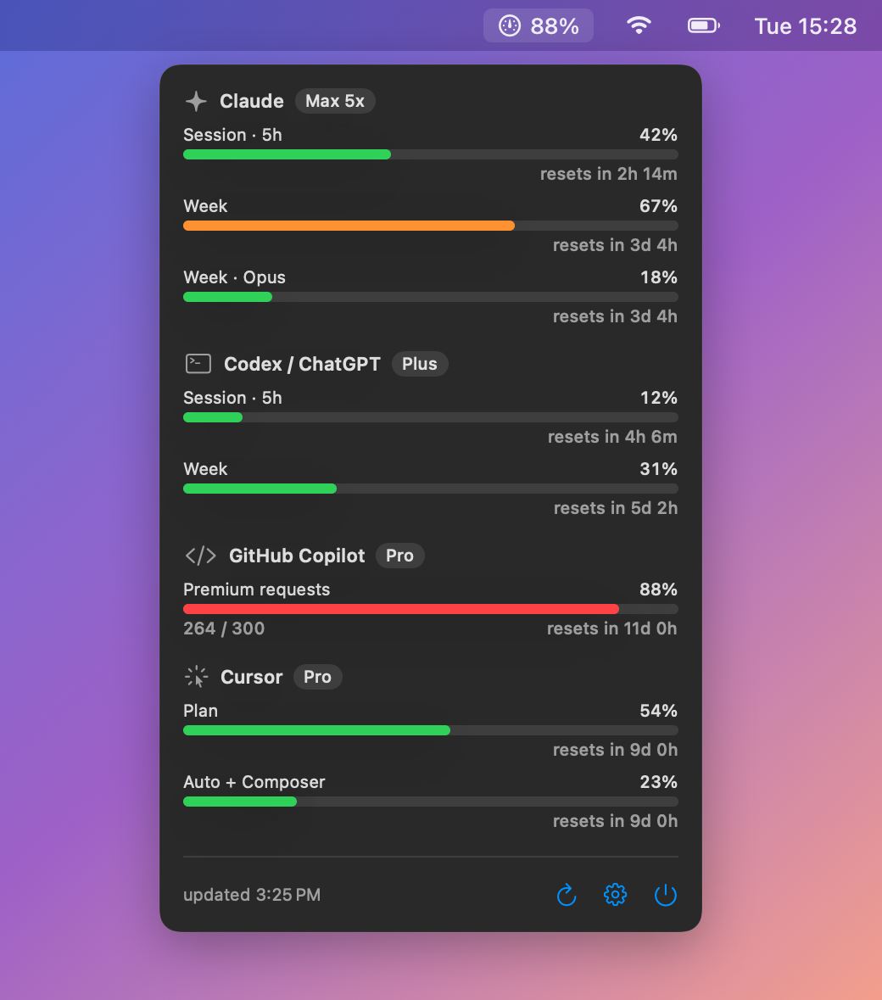
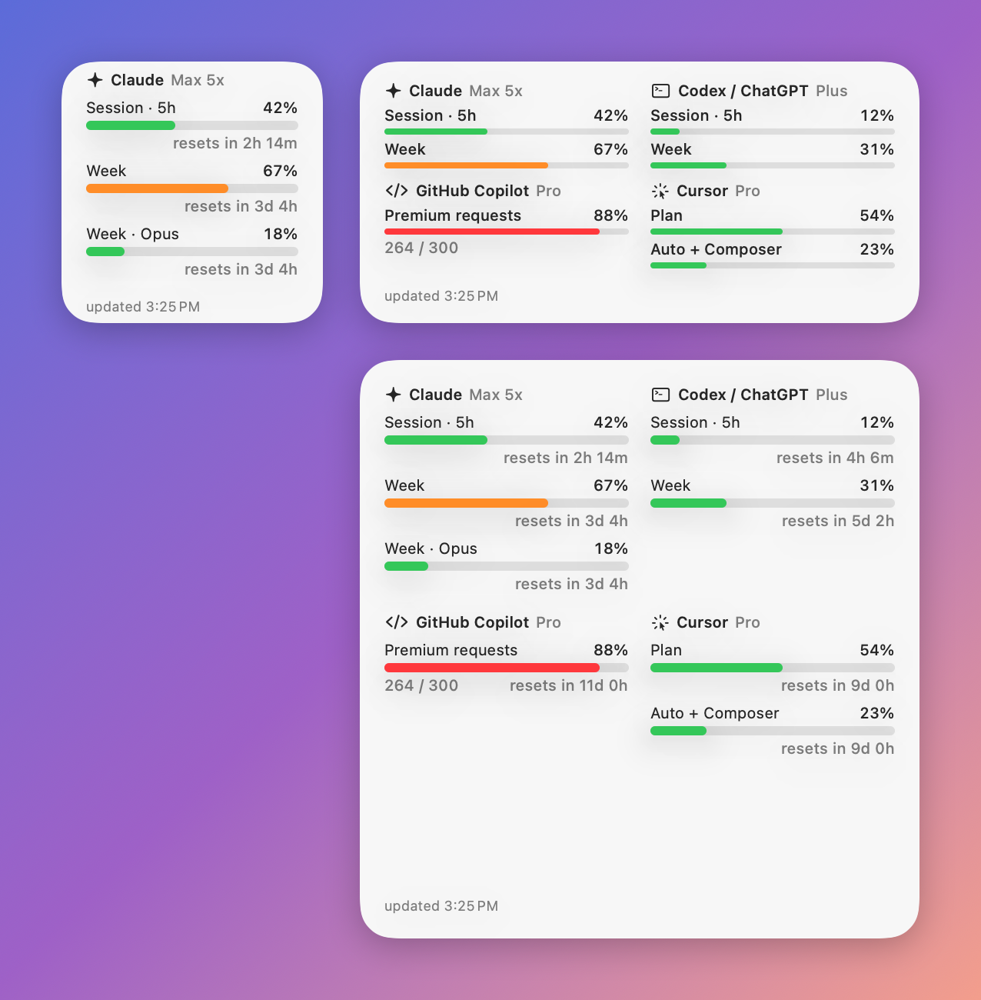
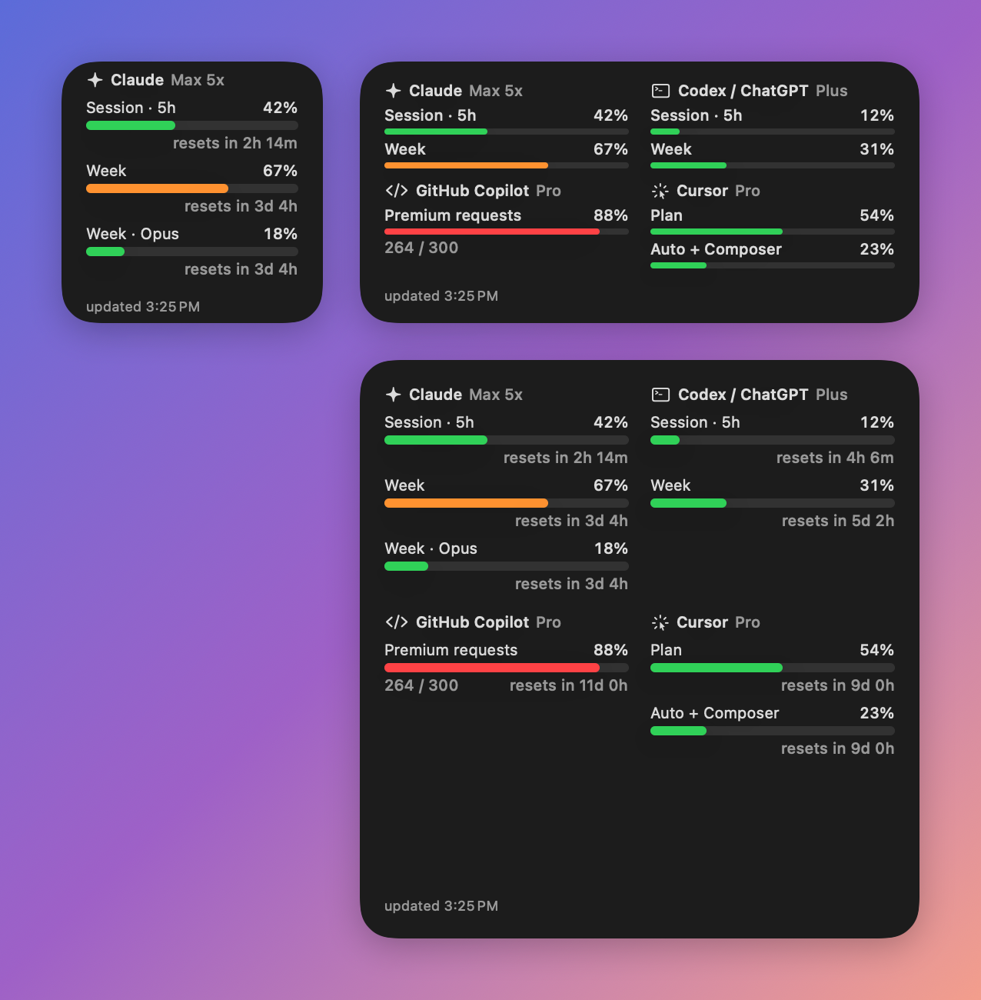
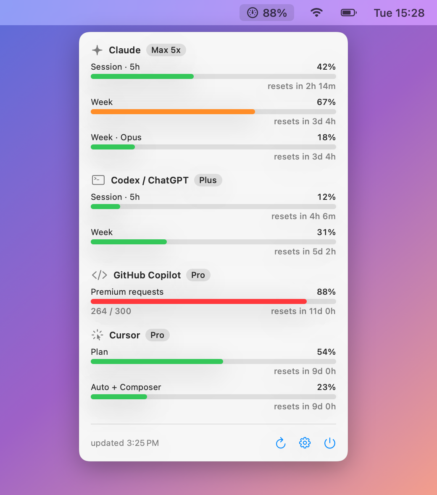
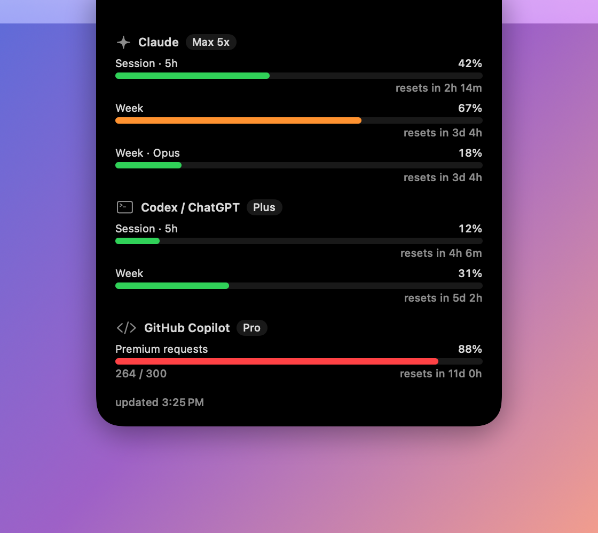

# LimitsWatcher

<p align="center">
  
</p>

A macOS menu bar app and desktop widget that shows how much of your AI subscription limits you have used:
Claude (5-hour session, weekly, per-model, plus API spend), Codex / ChatGPT, GitHub Copilot, Cursor and Gemini.

- **Menu bar** — an icon with the highest usage, and a popover with every service, its limits and reset times.
- **Desktop widget** — small (one service), medium (up to 4) and large (up to 6).
- **Notch outline** — on MacBooks with a notch, a line around it fills up with the first limit of your top service.
  Hover the notch and a panel with full stats unfolds from it.
- **Notifications** — when a limit reaches a threshold (one for all services or one per service) and when a limit resets.
- **Your order** — pick which service comes first; it drives the small widget and the notch outline.
- English and Russian, light and dark appearance. Services you aren't signed in to are hidden.

## Screenshots

**Desktop widgets** — small, medium and large, light and dark:

<p>
  
  
</p>

**Menu bar popover:**

<p>
  
  
</p>

**Notch outline** — fills with the first limit of your top service; hover the notch to unfold the details:

<p>
  
</p>
<p>
  
</p>

<sub>Screenshots use demo data.</sub>

## Install

1. Download `LimitsWatcher-1.0.dmg` from [Releases](../../releases).
2. Open it and drag **LimitsWatcher** to **Applications**.
3. The app isn't notarized by Apple, so the first launch is blocked. Open it once, then go to
   **System Settings → Privacy & Security** and click **Open Anyway**. Or run:
   ```bash
   xattr -dr com.apple.quarantine /Applications/LimitsWatcher.app
   ```
4. Launch it. The gauge icon appears in the menu bar; there is no Dock icon.

Requires macOS 14 Sonoma or later, Apple silicon or Intel.

**Widget:** right-click the desktop → **Edit Widgets…** → search for "AI Limits" → drag a size onto the desktop.
If it isn't listed yet, launch the app once and wait a minute.

## Connecting services

Open the menu bar icon → gear → **Services**.

| Service | What it needs |
|---|---|
| Claude (subscription) | A signed-in [Claude Code](https://code.claude.com) (`claude`). macOS asks for access to the "Claude Code-credentials" Keychain item — choose **Always Allow**. |
| Claude API | An Admin API key (`sk-ant-admin…`, organizations only). Set a monthly budget to get a percentage. |
| Codex / ChatGPT | A signed-in Codex CLI (`codex login`). |
| GitHub Copilot | The Copilot plugin in VS Code / JetBrains, or a token pasted in the settings (`gh auth token`). |
| Cursor | The `WorkosCursorSessionToken` cookie from cursor.com (DevTools → Application → Cookies). |
| Gemini | A signed-in Gemini CLI (`gemini`). Since 2026-06-18 Google only serves this login for Workspace / Standard accounts. |

Secrets typed into the settings are stored in the Keychain.

## Where the numbers come from

| Service | Source | Shows |
|---|---|---|
| Claude (subscription) | `GET api.anthropic.com/api/oauth/usage` with the Claude Code token | 5-hour session, week, per-model weeks |
| Claude API | Admin API `/v1/organizations/cost_report` | spend this month (% of budget if set) |
| Codex | `GET chatgpt.com/backend-api/wham/usage` with the token from `~/.codex/auth.json` | 5-hour and weekly windows |
| Copilot | `GET api.github.com/copilot_internal/user` | premium requests, chat |
| Cursor | `GET cursor.com/api/usage-summary` with the cookie | plan, Auto + Composer, API |
| Gemini | `POST cloudcode-pa.googleapis.com/v1internal:retrieveUserQuota` | Pro / Flash quotas |

The app talks only to these addresses. The widget never goes online and never sees a token: the menu bar app
writes ready-made percentages into an App Group container and the widget reads them.

## Good to know

- **The endpoints are undocumented** (except the Admin API). Any provider can change or close them without notice.
  If a card says the format may have changed, **Settings → Diagnostics** shows each raw response; parsing lives in
  `App/Providers/`. Response formats were taken from the open-source [CodexBar](https://github.com/steipete/CodexBar)
  documentation.
- **Claude rate-limits its usage endpoint hard** (HTTP 429 with `retry-after: 0`). LimitsWatcher backs off
  (5 → 10 → 20 → 60 min) and meanwhile reads the numbers Claude Code passes to its statusline, if a statusline script
  saves them to `~/.claude/usage_snapshot.json`.
- **Tokens are never refreshed.** Claude Code and Codex refresh tokens are single-use; refreshing them here would sign
  the CLI out. When a token expires, run `claude` / `codex` / `gemini` once.
- If a refresh fails, cards keep the previous numbers with an orange clock badge.
- The app is not sandboxed: it reads `~/.claude`, `~/.codex`, `~/.gemini` and the Claude Code Keychain item.

## Troubleshooting

- **Widget is empty or says "App Group unavailable"** — launch the app once and give it a minute; if it persists, reinstall from the DMG.
- **Widget doesn't update** — macOS throttles widget redraws; the app asks for one after every refresh, but the
  system may postpone it.
- **Claude card: "token expired"** — run `claude`. **"403 Cloudflare"** — switch network / VPN.

## Project layout

```
App/        menu bar app: providers, notch outline, notifications, settings
Shared/     models, App Group store, localization, SwiftUI pieces shared with the widget
Widget/     WidgetKit extension
Icon/       icon generator and AppIcon.icns
docs/       screenshots for this README
```
